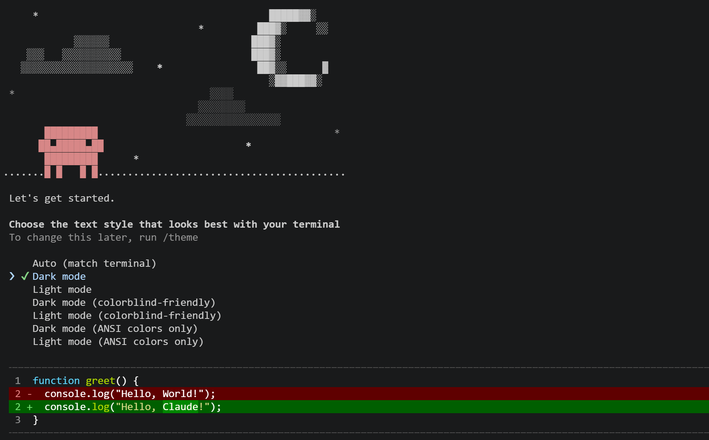
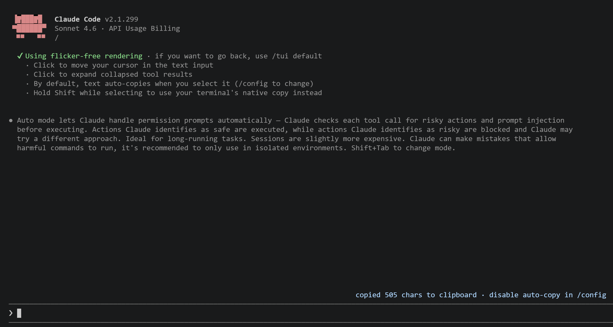

# REA Claude Code (v2.1.299 Full Source Reconstruction)

[](./manifest.json)
[](./module-map.json)
[](./self-test-report.json)

本项目基于 **REA (Reverse Engineer Anything)** 静态与运行时分析工具链，对 **Claude Code v2.1.299**（Commit `c416f56ec7eca27e49747c35af51d5c92c856ba1`）的单文件 ELF 二进制进行了**100% 完整解包、AST 语法级源码格式化、内嵌资产全量解压还原、网关指纹脱敏与单文件重封包**。

---

## 核心特性

- **100% 源码完整还原**：从 `.bun` 节（`StandaloneModuleGraph`）无损提取全部 **2,619 个内嵌模块**（包含 2,375 个格式化后的 JS 模块、138 个 `.zst` 压缩包、72 个 Markdown 技能文档、25 个文本模板及 2 个原生 N-API 扩展）。
- **剥离 `@anthropic-ai/bun-internal` 专用运行时**：自动提取包含 21 个私有原生 C++/Rust 绑定（如 `Bun.ant.CellSegmenter`、`setDumpable`、`getPeerPid`）的专用运行时 `bin/bun-ant`，确保所有 Ink TUI 界面与子命令 100% 原生运行。
- **17 套官方内置 Skills & Plugins 目录树重组**：完整还原 `claude-test`、`claude-api`（含 8 种语言 SDK 与 Managed Agents 指南）、`design-sync`、`data-visualization` 等全部官方内嵌技能包。
- **第三方网关与本地模型无缝兼容**：已移除导致第三方/本地网关触发 429 限流的官方 SDK 固定指纹串，并屏蔽非官方网关计费警告横幅，原生支持接入任意 Anthropic Messages API / OpenAI 兼容网关（如 DeepSeek、Qwen、GLM、vLLM、LiteLLM）。
- **原生本地纯净隔离启动方案**：提供 `scripts/run-isolated.sh`（基于 `env -i` 与独立 `CLAUDE_CONFIG_DIR`），无需容器即可在本地启动零第三方插件、零外部 Skill、零外部 MCP 干扰的 100% 纯净原生会话。
- **支持一键修改与单文件 ELF 重封包**：修改 `src/` 下的任意 JS 源码后，可通过 `bun run pack` 重新封包为 **零外部依赖的单文件 Linux x64 ELF 可执行文件** 及 **标准 NPM 全局安装包（`.tgz`）**。

---

## 目录结构

```text
rea-claude-code/
├── bin/
│   ├── claude                         # 源码模式启动入口（调用 bin/bun-ant 运行 src/cli）
│   └── bun-ant                        # [生成产物] 剥离出的 @anthropic-ai/bun-internal 运行时
├── entrypoints/                       # 17 个核心子系统语义化入口（映射混淆的 chunk-xxxx.js）
│   ├── cli-main.js                    # CLI 主控入口与命令分发器
│   ├── core-tools.js                  # 6 大核心工具：bash, read, write, edit, glob, grep
│   ├── model-catalog.js               # 内置模型目录（22 个模型定义、上下文窗口与计费梯度）
│   ├── api-client-and-prompts.js      # API 客户端、BaseURL 路由与基础 System Prompts
│   ├── agent-orchestrator.js          # 主对话循环、60+ 斜杠命令与 CLAUDE.md 上下文加载器
│   ├── sdk-protocol-schemas.js        # Messages API、MCP 控制面与权限模式的 Zod Schema
│   ├── subagents-and-tasks.js         # Subagent 派生调度（worker / fork / code-reviewer）
│   ├── coordinator-mode.js            # 多 Agent 协调器（Coordinator Mode）提示词与编排
│   ├── permissions-and-bypass.js      # 权限网关、Bypass 审批与 Root 安全拦截器
│   ├── env-and-flags-registry.js      # 975 个环境变量与内部实验代号注册表
│   ├── chrome-browser-tools.js        # Claude in Chrome 浏览器自动化工具集
│   ├── web-search-tool.js             # WebSearch 搜索工具实现
│   ├── builtin-plugins-loader.js      # 11 个内置 cc-plugin-* Function-Hook 插件加载器
│   ├── growthbook-flags.js            # GrowthBook 特性开关客户端
│   ├── fleet-view-ui.js               # FleetView 全屏多 Agent 终端 UI
│   ├── brief-send-user-message.js     # SendUserMessage (Brief / Pewter Owl) 主动通信工具
│   └── embedded-asset-loader.js       # Zstandard (.zst) 与内嵌资源加载器
├── src/                               # 2,619 个解包并完成 AST 缩进美化的运行时源码模块
├── extracted-assets/                  # 解压还原的可读资产库
│   ├── skills-and-plugins/            # 17 套完整重组还原的官方内置 Skills 与 Plugins
│   ├── prompts/                       # 提取的系统提示词、多 Agent 提示词与工具契约文档
│   ├── vendor-bundles/                # 解压后的 mermaid.min.js / chart.umd.min.js / hljs
│   └── all-raw-decompressed/          # 全量 138 个 .zst 压缩包解压后的明文文件
├── schemas/                           # 完整类型声明、JSON Schema 与数据字典
│   ├── model-catalog.json             # 官方内嵌模型表原件（22 个模型）
│   ├── sdk-tools.d.ts                 # 所有内置工具的完整 TypeScript 入参/出参类型定义
│   ├── claude-code-plugin.d.ts        # 642 KB 完整插件系统 TypeScript 声明文件
│   ├── claude-code-settings.schema.json # settings.json 完整 JSON Schema 校验文件
│   ├── env-vars.json                  # 975 个环境变量及引用位置索引
│   └── tools-and-commands.json        # 124 个内置工具与斜杠命令完整清单
├── scripts/                           # 自动化逆向提取、美化、测试与打包流水线脚本
│   ├── extract-from-binary.py         # 从官方 ELF 提取 .bun 节模块、解码 UTF-16LE 并生成 bun-ant
│   ├── format-sources.mjs             # 使用 Terser AST 将 2,375 个 JS 模块格式化为可读代码
│   ├── reconstruct-assets.mjs         # 重组 17 套内置技能树并解压全部 .zst 资产
│   ├── build-module-map.py            # 构建模块依赖图谱与符号索引
│   ├── pack-binary.py                 # 将修改重新封包为单文件 ELF 二进制与 NPM 安装包
│   ├── self-test.py                   # 11 项全量端到端自动化自测套件
│   └── run-isolated.sh                # 本地零污染纯净隔离环境启动脚本
├── manifest.json                      # 2,619 个内嵌模块的二进制偏移、Loader 类型与 SHA-256 清单
├── module-map.json                    # 2,375 个 JS 模块的导入/导出符号关系图谱
└── package.json                       # 项目配置与快捷脚本定义
```

---

## 标准使用教程

### 教程一：快速开始（直接运行与打包）

#### 1. 环境准备
- 操作系统：Linux x86_64（glibc）
- 基础依赖：`python3 >= 3.10`、`bun >= 1.2`、`terser`（可选，用于代码美化）

#### 2. 从源码直接运行
如果你希望直接运行 `src/` 下的明文源码（修改代码后无需重新打包即可立即生效）：
```bash
# 首次克隆仓库后，从本地已安装的官方 claude 提取 bun-ant 运行时（若已存在可跳过）
python3 ./scripts/extract-from-binary.py && bun run format

# 查看版本与帮助
./bin/claude --version --verbose
./bin/claude --help
```

#### 3. 一键打包生成独立单文件二进制与 NPM 安装包
```bash
bun run pack
```
打包完成后，将在 `./dist/` 下生成三个标准产物：
1. `./dist/claude`（253 MiB）：**单文件独立可执行程序**（零外部依赖，可直接拷贝到任何 Linux x64 机器运行）。
2. `./dist/anthropic-ai-claude-code-2.1.299-reconstructed.tgz`：可通过 `npm install -g` 全局安装的 NPM 包。
3. `./dist/claude-code-2.1.299-source-bundle.tar.gz`：完整可读源码与资产归档包。

---

### 教程二：在本地使用 100% 纯净隔离环境运行（屏蔽第三方 Plugin / Skill / MCP）

当宿主机 `~/.claude/` 和 `~/.claude.json` 中安装了第三方插件（如 `memory-module`）、外部 Skills 或 MCP Server 时，可通过以下两种方式获得**完全纯净的原生 Claude Code 环境**：

#### 方式 A：使用项目内置的隔离启动脚本 `scripts/run-isolated.sh`（推荐）
该脚本通过 `env -i` 和独立的 `CLAUDE_CONFIG_DIR=./.isolated-env/home/.claude` 启动，彻底隔离宿主机的 `~/.claude` 与 `~/.claude.json`：
```bash
# 验证纯净度（无任何外部插件与 MCP）
./scripts/run-isolated.sh plugin list
./scripts/run-isolated.sh mcp list

# 在纯净环境中启动交互式对话或单次提问
ANTHROPIC_BASE_URL="http://127.0.0.1:8012" \
ANTHROPIC_API_KEY="sk-your-key" \
./scripts/run-isolated.sh -p "你好"
```

#### 方式 B：使用原生 CLI 隔离参数
直接调用 `./dist/claude` 或 `./bin/claude` 时带上 `--setting-sources ""`（忽略用户/项目配置文件）与 `--strict-mcp-config`（忽略全局 MCP）：
```bash
./dist/claude --setting-sources "" --strict-mcp-config
```

---

### 教程三：接入自定义模型网关（DeepSeek / Qwen / GLM / OpenAI 代理）

还原版已消除了官方客户端对第三方网关的指纹限制与警告，可通过环境变量对接任意兼容 **Anthropic Messages API (`/v1/messages`)** 的网关：

```bash
export ANTHROPIC_BASE_URL="http://127.0.0.1:8012"   # 你的网关地址（如 8011 / 8012 / LiteLLM / One-API）
export ANTHROPIC_API_KEY="sk-any-key"               # 网关密钥
export ANTHROPIC_MODEL="claude-sonnet-4-6"          # 网关映射的模型名
export CLAUDE_CODE_DISABLE_NONESSENTIAL_TRAFFIC=1   # 禁用非必要的后台遥测请求

# 单次非交互式调用 (-p)
./dist/claude -p "用一句话介绍快速排序"

# 启动交互式 TUI 终端
./dist/claude
```

---

### 教程四：二次开发与自定义修改指南

你可以通过 `./entrypoints/` 下的语义化入口快速定位并修改 Claude Code 的内部行为：

| 想要修改的功能 | 对应源码文件 | 关键函数 / 变量定位 |
| :--- | :--- | :--- |
| **修改默认 System Prompt** | `src/chunk-gmq0qwep.js` | 搜索变量 `el`、`Bd`、`Hd` 及组装函数 `WTs` |
| **修改 6 大内置工具 (`bash`/`edit`/`read` 等)** | `src/chunk-8h81c13v.js` | 搜索 `name: "bash"`、`name: "edit"`、`name: "read"` |
| **新增或修改内置模型参数与上下文窗口** | `src/chunk-cjt10y7b.js` | 搜索导出对象 `cIr`（即内置 `model-catalog.json`） |
| **修改 Root 下禁用 `--dangerously-skip-permissions` 的限制** | `src/chunk-5ky29xgm.js` | 搜索函数 `refuseBypassUnderRoot`（内部函数 `g`） |
| **修改 Subagent 类型与并发上限** | `src/chunk-q9kxwt6x.js` | 搜索 `subagent_type` 或环境变量 `CLAUDE_CODE_MAX_CONCURRENT_SUBAGENTS` |
| **修改多 Agent 协调器 (Coordinator Mode) 提示词** | `src/chunk-1qs7jgw6.js` | 搜索 `You are Claude Code, an AI assistant that orchestrates` |

**修改后的测试与打包流程**：
1. 直接运行 `./bin/claude` 测试修改效果（`./bin/claude` 直接加载 `src/` 下的 `.js` 文件，无需编译即可生效）。
2. 测试通过后，运行 `bun run pack` 将修改重新写入 `./dist/claude` 单文件二进制。

---

### 教程五：运行 11 项全量端到端自动化自测套件

项目内置了完整的自动化测试脚本 `scripts/self-test.py`，覆盖版本校验、帮助树、`8011`/`8012` 双网关通信、内置 Function-Hook 插件生命周期、JSON / Stream-JSON 流式输出、6 大核心工具（`Glob`/`Grep`/`Read`/`Edit`/`Write`/`Bash`）闭环修 Bug、多轮会话持久化与 `--resume` 恢复、`--agents` 自定义 Subagent 派生委托、`--mcp-config` 挂载本地 Stdio MCP Server 调用，以及安全权限拦截测试：

```bash
bun run test
```

---

## NPM 快捷脚本一览 (`package.json`)

| 命令 | 说明 |
| :--- | :--- |
| `bun run start` | 直接通过源码启动 Claude Code |
| `bun run isolated` | 在本地零污染纯净隔离环境中启动 Claude Code |
| `bun run extract` | 从官方二进制提取全部 2,619 个模块并生成 `bin/bun-ant` |
| `bun run format` | 将 `src/` 下全部 2,375 个 JS 模块格式化为可读缩进代码 |
| `bun run reconstruct-assets` | 解压全部 `.zst` 压缩包并重组 17 套官方 Skills/Plugins 目录树 |
| `bun run build-map` | 生成 `module-map.json`、`schemas/env-vars.json` 等分析索引 |
| `bun run rebuild-all` | 一键顺序执行 `extract` -> `format` -> `reconstruct-assets` -> `build-map` |
| `bun run pack` | 将当前源码修改打包为 `./dist/claude` 单文件二进制与 `.tgz` 发布包 |
| `bun run test` | 运行 11 项全量端到端自动化自测 |

---


## 示例





## 声明与许可说明

本项目仅用于逆向工程架构研究、Agent 系统设计分析、安全审计与本地兼容网关测试。原始二进制与内置资产的版权归属 Anthropic PBC 所有（详见软件内附带的商业服务条款说明）。
